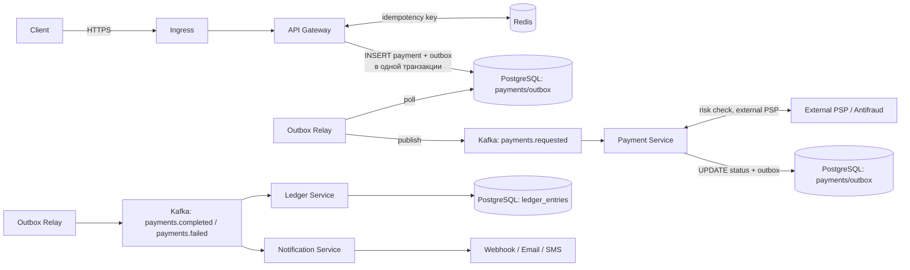

# Payment Platform

A payment processing platform I built to demonstrate high-load architecture. Built with Go, designed to handle **1M+ requests/day** with proper scaling patterns.

## Stack

| Component | Tech |
|-----------|------|
| Language | Go 1.22+ |
| Database | PostgreSQL 15 (partitioning, read replicas) |
| Message broker | Kafka 3+ (partitioning by payment/user ID) |
| Cache | Redis 7 (cluster mode) |
| Orchestration | Kubernetes (HPA, PDB, NetworkPolicy) — k8s for short |
| Observability | Prometheus + Grafana + Jaeger + Loki |

## Architecture



The system uses an outbox pattern to ensure reliable message delivery without distributed transactions. Payment requests flow through an API Gateway which validates idempotency keys and writes to PostgreSQL. A background relay picks up outbox events and publishes them to Kafka. Downstream services (payment processor, ledger, notifications) consume these events asynchronously.

**Flow:**
1. Client sends `POST /v1/payments` with `Idempotency-Key` header
2. Gateway checks Redis for existing key (prevents duplicates on retry)
3. In a single DB transaction: creates payment record + outbox event
4. Outbox relay publishes events to Kafka (no 2PC needed)
5. Payment service processes: risk check, calls external PSP, updates status
6. Results flow to ledger service (double-entry bookkeeping) and notification service

## What makes it scale

- **Horizontal scaling**: everything is stateless, pods scale via HPA
- **Kafka as buffer**: absorbs traffic spikes without hammering Postgres or external APIs
- **Redis**: offloads idempotency checks and rate limiting
- **Postgres partitioning**: by month on `created_at`, read replicas for reporting
- **Connection pooling**: PgBouncer in front of Postgres
- **Backpressure**: Kafka consumers limit `max.poll.records`

## Numbers (rough estimate)

- 1M requests/day ≈ 11.6 RPS average
- Peak traffic can be 8-15x average (depending on payment schedule)
- Each API Gateway pod handles ~300-500 RPS → 3+ replicas for HA
- Payment service is the bottleneck (external PSP call ~200ms) → scale workers based on latency

## Repo Structure

```
services/
  api-gateway/          # HTTP API, idempotency, writes to outbox
  payment-service/      # Process payment, antifraud, external PSP call
  ledger-service/       # Double-entry bookkeeping
  notification-service/ # Webhooks/notifications
migrations/             # SQL migrations
k8s/                    # Kubernetes deployment manifests (the "k8s" is just short for "Kubernetes" — 8 letters between k and s)
docker-compose.yml      # Local development setup
```

## Local Run

```bash
docker compose up --build
```

```bash
curl -X POST localhost:8080/v1/payments \
  -H "Idempotency-Key: $(uuidgen)" \
  -H "Content-Type: application/json" \
  -d '{"user_id":"u1","amount":1500,"currency":"RUB","recipient":"merchant-42"}'
```

## Production Considerations

Stuff I'd add before putting this in production:
- mTLS between services
- Vault/External Secrets for credentials
- Circuit breaker around external PSP (already using gobreaker)
- DLQ topics for failed messages
- PCI DSS compliance for card data (tokenization)
- Schema Registry for Kafka messages (Avro/Protobuf)

## Why I Built This

I wanted to see if I could design a payment system that doesn't fall apart under load. The outbox pattern keeps things simple without requiring distributed transactions. Everything is async where it makes sense, synchronous where it doesn't.

Most of the patterns here came from working on real payment systems and reading "Designing Data-Intensive Applications."