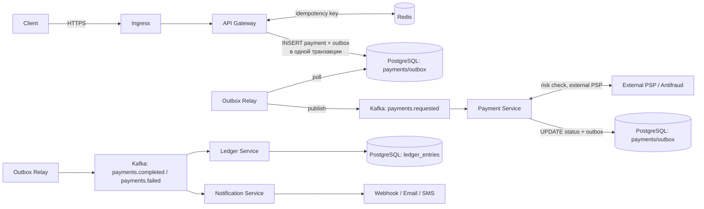

# Платформа обработки платежей

Микросервисная платформа на Go для обработки платежей с расчётной нагрузкой
**> 1 000 000 запросов/сутки** (в среднем ≈ 12 RPS, пиковая нагрузка до
150–300 RPS с учётом суточной неравномерности x10–x20).

## Стек

| Компонент          | Технология                              |
|--------------------|------------------------------------------|
| Языки              | Go 1.22+                                  |
| БД                 | PostgreSQL 15 (партиционирование, реплики на чтение) |
| Брокер сообщений   | Apache Kafka (3+ брокера, партиции по payment/user id) |
| Кэш / idempotency  | Redis 7 (cluster mode)                    |
| Оркестрация        | Kubernetes (HPA, PodDisruptionBudget, NetworkPolicy) |
| Наблюдаемость      | Prometheus + Grafana + Jaeger + Loki      |

## Архитектура



### Поток обработки платежа

1. **API Gateway** принимает `POST /v1/payments` с обязательным заголовком
   `Idempotency-Key`. Ключ проверяется в Redis (`SETNX` с TTL 24ч) — при
   повторном запросе с тем же ключом возвращается ранее сохранённый ответ
   (защита от дублей при ретраях клиента).
2. В **одной SQL-транзакции** создаётся запись в `payments` (status=`pending`)
   и запись в `outbox_events` (transactional outbox pattern — гарантирует,
   что событие не потеряется и не будет отправлено без записи в БД, и
   наоборот).
3. **Outbox Relay** (горутина в составе сервиса) опрашивает `outbox_events`
   (`SELECT ... FOR UPDATE SKIP LOCKED`), публикует в Kafka и помечает
   событие как отправленное. Это даёт **at-least-once** доставку без
   двухфазных коммитов.
4. **Payment Service** (consumer group, партиции по `payment_id` — сохраняют
   порядок в рамках одного платежа) выполняет бизнес-логику: антифрод-чек,
   вызов внешнего процессинга, обновление статуса. Идемпотентность на этом
   шаге обеспечивается уникальным constraint по `payment_id` + проверкой
   текущего статуса перед переходом (state machine: `pending → processing →
   completed|failed`).
5. Результат публикуется в `payments.completed` / `payments.failed` через тот
   же outbox-паттерн.
6. **Ledger Service** пишет двойную запись (double-entry bookkeeping —
   дебет/кредит) в таблицу `ledger_entries`, консистентность обеспечивается
   уникальным индексом `(payment_id)`.
7. **Notification Service** отправляет вебхуки/уведомления клиенту.

## Почему это выдерживает 1M+ запросов/сутки

- **Горизонтальное масштабирование**: все сервисы stateless, масштабируются
  через `HorizontalPodAutoscaler` по CPU/RPS (custom metrics через
  Prometheus Adapter).
- **Kafka как буфер**: пиковые всплески не бьют напрямую в Postgres/внешний
  процессинг — consumer group обрабатывает с контролируемой скоростью,
  партиции дают параллелизм (рекомендация: 12–24 партиции на топик).
- **Redis** снимает нагрузку с БД на идемпотентность и rate-limiting
  (sliding window per user/API key).
- **PostgreSQL**: партиционирование `payments` по `created_at` (месяц),
  индексы по `idempotency_key` (unique), `status`, `user_id`; read-реплики
  для отчётности/аналитики, чтобы не грузить primary.
- **Connection pooling**: PgBouncer перед Postgres, ограничение соединений
  на под.
- **Backpressure**: consumer'ы Kafka с ограничением `max.poll.records` и
  собственным пулом воркеров, чтобы не перегружать БД/внешний PSP.

## Расчёт мощности (ориентир)

- 1 000 000 запросов/сутки ≈ 11.6 RPS в среднем.
- Пиковый коэффициент (день/вечер vs ночь) — обычно x8–x15 → пик ≈ 100–170 RPS.
- Каждый под API Gateway обрабатывает ~300–500 RPS (простая валидация +
  запись в Redis/PG) → 2–3 реплики с запасом на отказоустойчивость (минимум
  3 для HA в разных зонах).
- Payment Service — самый тяжёлый (внешний вызов, антифрод) — расчёт от
  latency внешнего PSP (~200мс) и целевой пропускной способности:
  `workers = target_RPS * latency_sec` → при 170 RPS и 0.2с ≈ 34 параллельных
  воркера, распределённых по репликам и партициям.

## Структура репозитория

```
services/
  api-gateway/        # HTTP API, idempotency, outbox writer
  payment-service/     # обработка платежа, антифрод, внешний PSP
  ledger-service/       # двойная бухгалтерская запись
  notification-service/ # вебхуки/уведомления
migrations/            # SQL миграции
k8s/                    # манифесты Kubernetes
docker-compose.yml      # локальный стенд (Postgres, Redis, Kafka, сервисы)
```

## Локальный запуск

```bash
docker compose up --build
curl -X POST localhost:8080/v1/payments \
  -H "Idempotency-Key: $(uuidgen)" \
  -H "Content-Type: application/json" \
  -d '{"user_id":"u1","amount":1500,"currency":"RUB","recipient":"merchant-42"}'
```

## Production-хардненинг (что добавить дальше)

- mTLS между сервисами (Istio/Linkerd), NetworkPolicy запрещающая всё, кроме
  явно разрешённого трафика.
- Секреты — через Vault/External Secrets Operator, а не через plain
  Kubernetes Secret (в манифестах ниже — только для примера).
- Circuit breaker (например, `sony/gobreaker`) вокруг вызова внешнего PSP.
- Dead Letter Queue топики (`payments.requested.dlq`) для событий, которые
  не удалось обработать после N ретраев.
- PCI DSS: токенизация карточных данных, не хранить PAN/CVV в БД.
- Schema Registry (Avro/Protobuf) для Kafka-сообщений вместо "сырого" JSON.
